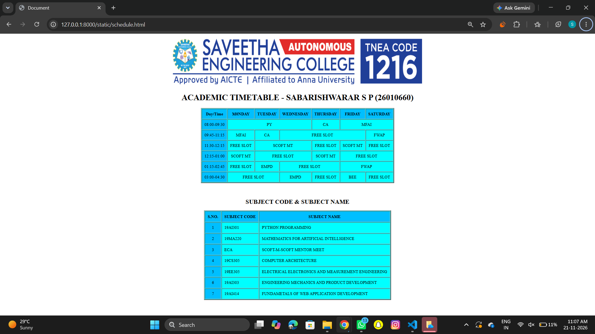

# Ex04 Time Table
## Date:21-11-2026

## AIM
To write a html webpage page to display your slot timetable.

## ALGORITHM
### STEP 1
Create a Django-admin Interface.

### STEP 2
Create an App inside the Django project.

### STEP 2
Create a static folder uder the created App and insert HTML code.

### STEP 3
Create a simple table using ```<table>``` tag in html with the relevant attributes.

### STEP 4
Add rows using ```<tr>``` tag.

### STEP 5
Add your course schedule using ```<td>``` tag.

### STEP 6
Execute the program using runserver command.

## PROGRAM
```
schedule.html

<html>
<head>
    <title>Document</title>
</head>
<body>
    <center>
        
        
        <h1>ACADEMIC TIMETABLE - SABARISHWARAR S P  (26010660)</h1>
        <table border="3" cellpadding="9" style="background-color: aqua">
            <tr style="background-color: deepskyblue;">
                <th>Day/Time</th>
                <th>M0NDAY</th>
                <th>TUESDAY</th>
                <th>WEDNESDAY</th>
                <th>THURSDAY</th>
                <th>FRIDAY</th>
                <th>SATURDAY</th>
            </tr>
            <tr>
                <td style = "background-color: deepskyblue;">08:00-09:30</td>
                <td colspan="3" style="text-align: center;">PY</td>
                <td style="text-align: center;">CA</td>
                <td colspan="2" style="text-align: center;">MFAI</td>
                
               
             
            </tr>
            <tr>
                <td style="background-color: deepskyblue;">09:45-11:15</td>
                <td style="text-align: center;">MFAI</td>
                <td style="text-align: center;">CA</td>
                <td colspan="3" style="text-align: center;">FREE SLOT</td>
               
                <td style="text-align: center;">FWAP</td>
               
            </tr>
            <tr>
                <td style="background-color:deepskyblue;">11:30-12:15</td>
                <td style="text-align: center;">FREE SLOT</td>
                <td colspan="2" style="text-align: center;">SCOFT MT</td>
                <td style="text-align: center;">FREE SLOT</td>
                <td style="text-align: center;">SCOFT MT</td>
                <td style="text-align: center;">FREE SLOT</td>
              
              
            </tr>
            <tr>
                <td style="background-color: deepskyblue;">12:15-01:00</td>
                <td style="text-align: center;">SCOFT MT</td>
                <td colspan="2" style="text-align: center;">FREE SLOT</td>    
                <td style="text-align: center;">SCOFT MT</td>
                <td colspan="2" style="text-align: center;">FREE SLOT</td>   
             
            </tr>
            <tr>
                <td style="background-color: deepskyblue;">01:15-02:45</td>
                <td style="text-align: center;">FREE SLOT</td>
                <td style="text-align: center;">EMPD</td>
                <td colspan="2" style="text-align: center;">FREE SLOT</td>
                <td colspan="2" style="text-align: center;">FWAP</td>
              
            
            
            </tr>
            <tr>
                <td style="background-color: deepskyblue;">03:00-04:30</td>
                <td colspan="2" style="text-align: center;">FREE SLOT</td>
                <td style="text-align: center;">EMPD</td>
                <td style="text-align: center;">FREE SLOT</td>   
                <td style="text-align: center;">BEE</td>
                <td style="text-align: center;">FREE SLOT</td>
             
            </tr>
        </table>
           
           
           
           
            <br>
            <br>


        <h2>SUBJECT CODE & SUBJECT NAME </h2> 
        <table border="3" cellpadding="10" style="background-color: aqua">
           <tr>
                <th style="background-color: deepskyblue;">S.NO.</th>
                <th style="background-color: deepskyblue;"> SUBJECT CODE</th>
                <th style="background-color: deepskyblue;">SUBJECT NAME</th>

            </tr>
            <tr> 
                <td style="background-color: deepskyblue; text-align: center;">1</td>
                <td>19AI301</td>
                <td>PYTHON PROGRAMMING</td>
            </tr>
            <tr>
                <td style="background-color: deepskyblue; text-align: center;">2</td>
                <td>19MA220</td>
                <td>MATHEMATICS FOR ARTIFICIAL INTELLIGENCE</td>
            </tr>
            <tr>
                <td style="background-color: deepskyblue; text-align: center;">3</td>
                <td>ECA</td>
                <td>SCOFT-M-SCOFT MENTOR MEET</td>
            </tr>
            <tr>
                <td style="background-color: deepskyblue; text-align: center;">4</td>
                <td>19CS305</td>
                <td>COMPUTER ARCHITECTURE</td>
            </tr>
            <tr>
                <td style="background-color: deepskyblue; text-align: center;">5</td>
                <td>19EE305</td>
                <td>ELECTRICAL ELECTRONICS AND MEASUREMENT ENGINEERING</td>
            </tr>
            <tr>
                <td style="background-color: deepskyblue; text-align: center;">6</td>
                <td>19AI303</td>
                <td>ENGINEERING MECHANICS AND PRODUCT DEVELOPMENT</td>
            </tr>
            <tr>
                <td  style="background-color: deepskyblue; text-align: center;">7</td>
                <td>19AI414</td>
                <td>FUNDAMETALS OF WEB APPLICATION DEVELOPMENT</td>
            </tr>
           
            
           
        </table>
    </center>
</body>
</html>
```


## OUTPUT



## RESULT
The program for creating slot timetable using basic HTML tags is executed successfully.
